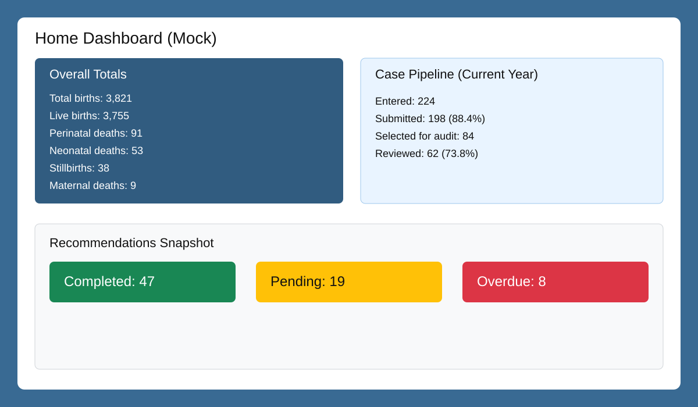
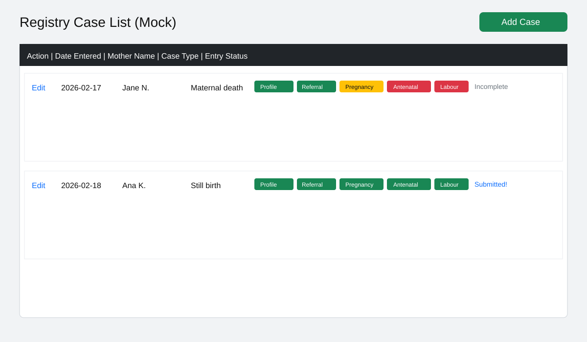
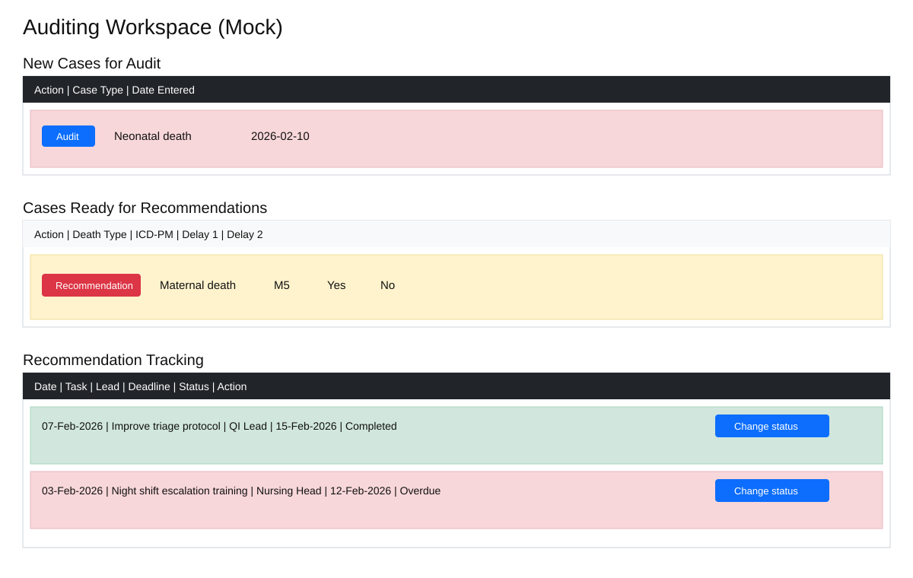
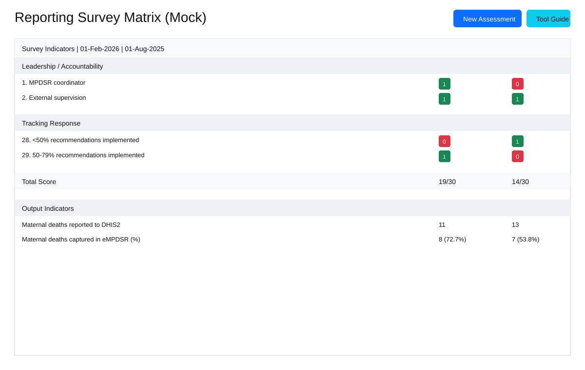
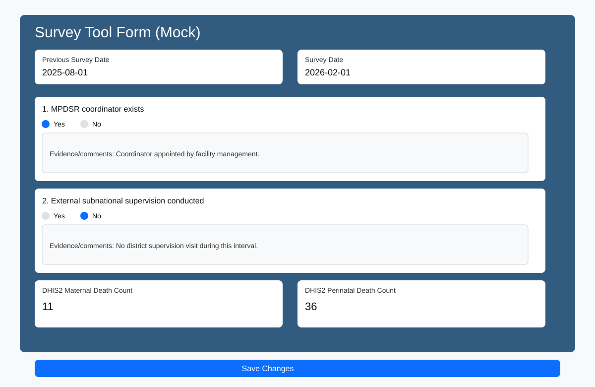

# PDSR User Tutorial

Visual index:
- `docs/tutorial-visuals/index.html`

## 1. Access and login

1. Start the application:
   - `mvn spring-boot:run`
2. Open your browser:
   - `http://localhost:5000`
3. Sign in with your assigned username and password.

The app home page shows modules based on your role:
- `ENTRY`: Registry (case entry)
- `AUDIT` / `TASKS`: Auditing
- `VIEWS`: Reporting
- `SETUP`: Controls (configuration and users)

## 2. First-time setup (SETUP role)

1. Go to `Controls` (`/controls`).
2. Fill in:
   - Facility code
   - Facility name (auto-populates if code exists in master facility list)
   - Contact email
   - Sync URL (central server URL)
3. Click Sync/Save.

This step initializes facility context and loads reference files (facilities, ICD codes, ICD diagnoses).

## 3. Main dashboard

After activation, `/` (Home) shows:
- Case counts (entered, submitted, selected, reviewed)
- Mortality and monitoring indicators
- Recommendation completion status
- National/Regional/District views if your role includes those levels

Tutorial visual:
- `docs/tutorial-visuals/home-dashboard-mock.html`

## 4. Registry workflow (ENTRY role)

1. Open `Registry` (`/registry`).
2. Click **Add case** (`/registry/add`).
3. Complete sections in order:
   - Profile
   - Referral
   - Pregnancy
   - Antenatal
   - Labour
   - Delivery
   - Birth
   - Outcome-specific page (Fetal heart / Baby death / Mother death)
   - Notes
4. Save updates as you move through tabs.
5. Submit case when complete (`/registry/submit/{id}`).

Tips:
- Color badges indicate section completion state.
- Incomplete sections keep case status as incomplete.

Tutorial visual:
- `docs/tutorial-visuals/registry-workflow-mock.html`

## 5. Auditing workflow (AUDIT / TASKS roles)

1. Open `Auditing` (`/auditing`).
2. Load available submitted cases.
3. Start audit (`/auditing/edit/{id}`).
4. Capture classification and contributing factors.
5. Add recommendations (`/auditing/recommend/{id}`).
6. Update recommendation status (`/auditing/cstatus/{id}`) as work progresses.

`TASKS` users can update recommendation/case status.  
`AUDIT` users perform full case audits.

Tutorial visual:
- `docs/tutorial-visuals/auditing-workflow-mock.html`

## 6. Reporting workflow (VIEWS role)

Open `Reporting` (`/reporting`) for three areas:

1. Visual analytics
   - `Reporting -> View visuals` (`/reporting/search`)
2. Survey tools
   - `Reporting -> View surveys` (`/reporting/survey`)
   - Create/edit tool form (`/reporting/survey/tool`)
3. Monthly data import/export
   - Download template: `/reporting/download/template`
   - Upload filled Excel file from `/reporting`
   - Open month data editor: `/reporting/edit/{year}/{month}`
   - Export Excel: `/reporting/export/excel/{year}/{month}`

### 6.1 Survey Tools (detailed)

Use Survey Tools to track MPDSR implementation maturity at facility level.

1. Open survey dashboard:
   - `Reporting -> View surveys` (`/reporting/survey`)
2. Start a new assessment:
   - Click **New Assessment**
   - A popup opens at `/reporting/survey/tool`
3. Fill survey metadata:
   - Previous survey date
   - Current survey date
4. Complete the implementation questions:
   - 30 Yes/No questions (each `Yes = 1`, `No = 0`)
   - Optional comments per question (evidence/notes)
5. Enter output counts:
   - DHIS2 maternal death count
   - DHIS2 perinatal death count
6. Save:
   - Click **Save Changes** to store draft/final values.

Question domains shown in the survey table:
- Leadership / Accountability
- Policy / Guidelines
- Structure / Coordination
- Review Meetings
- Tools
- Training / Staff Capacity
- Resources
- Community
- Implementation Culture
- Tracking Response

How scoring works:
- Total score is displayed as `X/30`.
- Higher score means more implementation elements are fully in place.
- Use the per-question comments to justify each Yes/No answer.

How review/validation works:
- By default, the survey author enters the tool.
- A different user can open the same assessment (from the survey matrix date link).
- Reviewer checks **review completed** (confirmation box) and saves.
- Once marked completed, the entry is treated as validated and key fields become locked in UI.

How output indicators in the survey matrix are calculated:
- The matrix shows DHIS2 totals you entered.
- It also shows counts/percentages captured in eMPDSR for notified and reviewed deaths between:
  - `prev_survey_date` and `survey_date`

How to read and reopen assessments:
- In `/reporting/survey`, each survey appears as a column labeled by survey date.
- Click a survey date to reopen that specific record in popup mode for review.
- Use **Tool Guide** (`/reporting/survey/summaries`) for built-in guidance text.

Tutorial visuals:
- `docs/tutorial-visuals/reporting-survey-matrix-mock.html`
- `docs/tutorial-visuals/reporting-survey-tool-mock.html`

Import requirements:
- Select year/month
- Choose file
- Set sheet index (starts at `0`)

## 7. User administration (SETUP role)

1. Open `Controls -> Users` (`/controls/users`).
2. Add new users (`/controls/users/add`):
   - Username
   - Email
   - Group/role
   - Facility
3. Update users or change password from user detail screens.

## 8. Merge and sync operations (SETUP role)

From Controls dashboard:
- Local/peer merge: `/controls/datamerge`
- Pull/download merge: `/controls/downloadmerge`
- Central push merge: `/controls/centralmerge`
- Delete case utility: `/controls/deletecase`

Use merge screens in planned operational windows and keep backups before bulk operations.

## 9. Sign out

Use the **Sign out** button at the top of the page (available globally).
